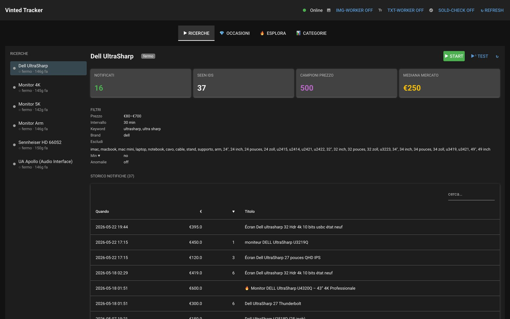
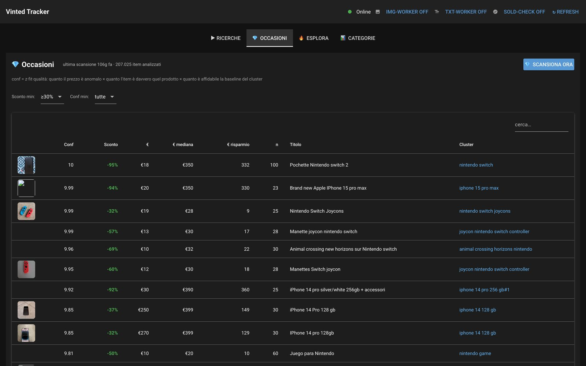
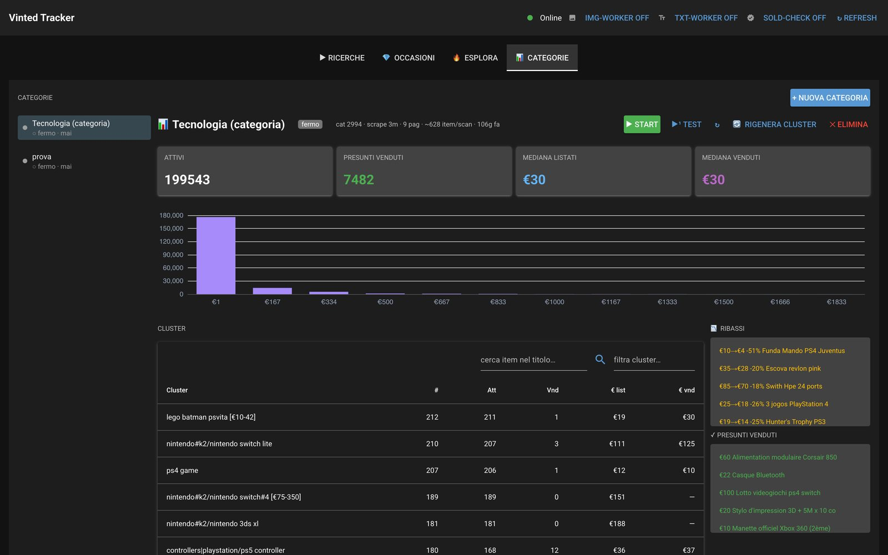

# Vinted Tracker

A personal tool for finding good deals on [Vinted](https://www.vinted.com), the second-hand marketplace: listings priced well below what the same product usually costs.

The hard part is "the same product". Listings are written however people like, in several languages, and a search for a monitor also returns cables, other sizes and other brands. Most of this project is the pipeline that groups listings of the same product into clean groups with coherent prices, so that a group's median price is a fair reference.


> This README describes the current version, a local web app. The first version (a desktop app that sent an alert for every new listing matching a search) is documented in [docs/README-prima-versione.md](docs/README-prima-versione.md).

---

## Screenshots







---

## What it does

The app runs on your computer and opens in the browser, with four tabs:

- **Ricerche** (searches): your saved searches with their filters (price, words, brands, exclusions), how many listings each has seen and the market median.
- **Occasioni** (deals): on demand, the listings priced furthest below the median of their product group, with how much the comparison can be trusted.
- **Esplora** (explore): a live search on Vinted, with every price compared to the median of its group.
- **Categorie** (categories): whole categories watched continuously, with active and presumably sold listings, the price distribution, the product groups and the price drops.

Behind the categories:

- **Catalogue scans** in several countries, stored in a local SQLite database.
- **Product groups.** Titles are cleaned (noise words in seven languages, families of translated words, model numbers split from letters), turned into multilingual text embeddings, partitioned by category and brand, and clustered with HDBSCAN. Groups whose prices have two peaks are split (a cable is not a cheap monitor). Photos are used only where prices still don't add up, to split a group holding two different objects. The full pipeline and its quality measures are described in [PIPELINE_BRIEFING.md](PIPELINE_BRIEFING.md).
- **Sold or removed.** A background check revisits active listings: if the page is still there but can no longer be bought, the item is presumably sold at its last price; if the page is gone, it was removed and does not count as a sale. Price drops are recorded too.

The groups are the baseline for a price-anomaly detector, which is not built yet: the deals tab is the first, simple use of the medians.

---

## Getting started

```bash
git clone https://github.com/Willy00blu/vinted-tracker.git
cd vinted-tracker
pip install -r requirements.txt
python -m webgui        # then open http://localhost:8080
```

On macOS, `run_webgui.command` does the same with a double click.

Optional, for notifications: copy `settings.example.json` to `settings.json` and fill in your Telegram bot token and chat id (from [@BotFather](https://t.me/BotFather)). `settings.json` is gitignored.

The repository includes one example search, `configs/monitor_4k.json`; your own searches are saved in `configs/` and are gitignored.

---

## Project structure

```
├── webgui/                 # the web app (NiceGUI): python -m webgui
├── core/
│   ├── vinted_client.py    # HTTP client, with an optional browser-like transport (curl_cffi) and a rate limiter
│   ├── category_monitor.py # catalogue scans for the watched categories
│   ├── category_db.py      # the SQLite schema and item operations
│   ├── clustering.py       # the grouping pipeline: cleaning, embeddings, HDBSCAN, refinements, evaluation
│   ├── text_worker.py      # background text embeddings
│   ├── image_worker.py     # background photo embeddings
│   ├── sold_check*.py      # the sold / removed / price-drop check
│   └── scraper.py, storage.py, notifier.py, network.py   # the search monitor of the first version
├── scripts/                # experiments, benchmarks and the regeneration of the groups
├── configs/monitor_4k.json # an example search
├── gui.py, monitor.py      # the first version's desktop app, kept for reference
└── PIPELINE_BRIEFING.md    # the grouping pipeline in detail
```

---

## Requirements

- Python 3.11+ (the launcher prefers 3.13 if installed)
- The packages in `requirements.txt`. `sentence-transformers` and `hdbscan` are optional: without them the grouping falls back to simpler tokens.
